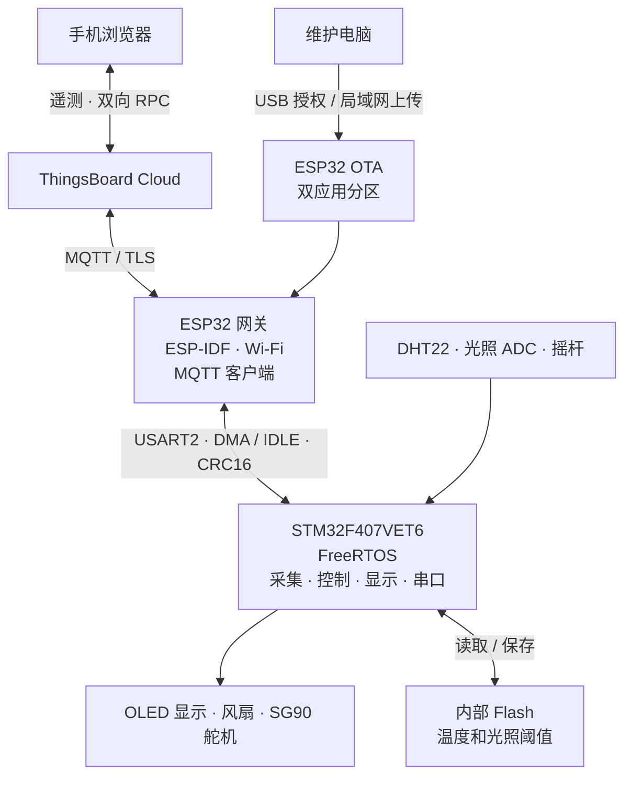
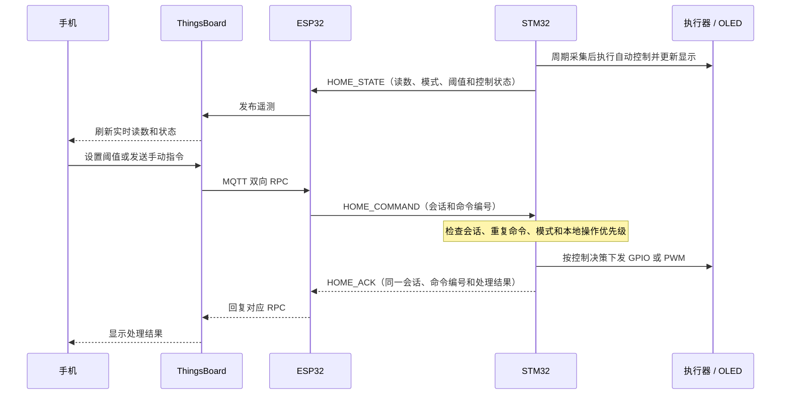

# 系统架构与数据流

STM32F407VET6 负责采集和实时控制。ESP32 负责联网，把现场状态发到 ThingsBoard，也把手机操作转成板间指令。家中网络断开时，风扇、窗帘和摇杆菜单仍由 STM32 运行。

## 系统架构

STM32 的采集、控制、显示和串口任务通过队列交换数据。监控任务检查各任务心跳并管理独立看门狗。控制任务根据当前模式、传感器有效性和阈值决定输出，OLED 显示的是控制状态，SG90 没有位置回读。

## 采集、控制与回执

- 阈值修改即时生效。最后一次变动满 2 秒且采集结束后，STM32 将最新两项设置追加到 Flash。开机扫描两扇区，校验 CRC 和提交字，恢复最新有效记录并进入 AUTO。
- OLED 空闲 30 秒时降低对比度，60 秒时熄屏并停写。摇杆拨动或按下唤醒，采集、控制和串口仍按原周期运行。
- OTA 维护走单独路径。电脑用 USB 一次性授权，再通过局域网把应用镜像上传到 ESP32 的备用分区。SHA-256 校验通过后才切换启动分区。新应用通过启动检查后确认，否则由引导程序回滚。

## 相关资料

- [项目演示视频（63 秒）](media/smart-home-demo.mp4?raw=true)
- [整机俯视接线](images/wiring-top-view.svg)与[上板配置](上板配置与验收.md#智能家居本地版)
- [板间帧、会话与 ThingsBoard 接口](通信协议.md)
- [ESP32 网关 OTA 操作步骤](网关固件OTA.md)
- [实机验收记录](软件验证记录.md)
