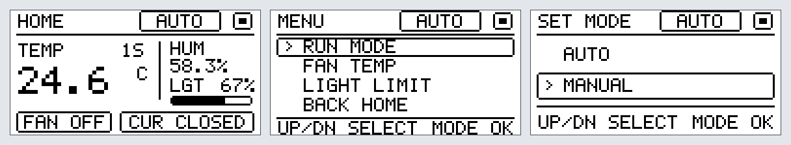
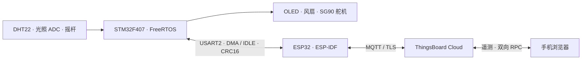

# 基于 STM32F407 + ESP32 的智能家居监测与远程控制系统

STM32F407 采集温湿度和光照，控制 5 V 风扇与模拟窗帘，并通过摇杆和 OLED 菜单提供本地操作。ESP32 通过 MQTT/TLS 连接 ThingsBoard Cloud，手机可以查看实时数据、切换模式、调节阈值和控制设备。网络断开时，STM32 继续运行本地控制。

[架构与数据流](Documents/系统架构与数据流.md) · [整机俯视接线](Documents/images/wiring-top-view.svg) · [演示视频（63 秒，MP4）](Documents/media/smart-home-demo.mp4?raw=true)

## 系统架构

- **本地联动** · STM32 用四个 FreeRTOS 任务处理采集、控制、显示与串口通信。自动模式按温度和光照阈值执行，风扇默认在 30 °C 开启、28 °C 停止。舵机通过 50 Hz PWM 控制，并限制连续位置命令的间隔。
- **阈值保存与熄屏** · 风扇开启温度和关帘光照阈值存入 STM32 Flash。调节完成后停留约 2 秒即可保存，重启回到自动模式并恢复已保存的阈值。OLED 空闲 30 秒变暗、60 秒熄屏，拨动或按下摇杆可唤醒。
- **控制回执** · ESP32 把 ThingsBoard RPC 转成板间命令。STM32 按会话和命令编号识别重试，本地菜单操作优先。网页显示控制回执以及固件下发的执行器状态。
- **故障恢复** · UART 解析器处理分片、粘包和坏帧。OLED 连续四次传输失败时，显示任务复位 I²C1 并重试。

## 从接线到面板

1. 使用 STM32F407VET6、NodeMCU-32S、DHT22、模拟光照模块、SSD1306 OLED、PS2 摇杆、JY-25-003 风扇套装和 SG90。完整供电与引脚表见[上板配置与验收](Documents/上板配置与验收.md#智能家居本地版)。板间串口为 STM32 `PA2/TX` → ESP32 `GPIO16/RX`、ESP32 `GPIO25/TX` → STM32 `PD6/RX`，并共地。
2. 在 STM32CubeIDE 2.2.0 中导入 `STM32/`。在 Debug 配置的 **C/C++ Build → Settings → MCU GCC Compiler → Preprocessor** 添加 `EDGE_HOME_PROFILE`、`EDGE_HOME_JOYSTICK` 和 `EDGE_HOME_UART_RX_PD6`。执行 Clean Build，通过 ST-Link 烧录 `STM32/Debug/STM32.elf`。
3. 使用 ESP-IDF v6.1，在 Windows 运行 `.\Tools\Build-ESP32.ps1 -Action menuconfig`。已激活 ESP-IDF 环境时，也可从根目录运行 `idf.py -C ESP32 menuconfig`。在 **Edge monitoring terminal** 启用 **Smart-home STM32 with MQTT** 和 **Use ThingsBoard Cloud over MQTT/TLS**，设置 UART2 TX=25、RX=16，并填入自己的 Wi-Fi、ThingsBoard 主机和设备 token。保存后构建并烧录，具体步骤见[云端接入](Documents/上板配置与验收.md#thingsboard-cloud-接入)。
4. 在 ThingsBoard 先导入[控制小部件](ThingsBoard/home-control-widget.json)，再导入[仪表盘](ThingsBoard/home-control-dashboard.json)。设备名使用 `home-01`，或将仪表盘的设备别名改为你的设备名。打开仪表盘后查看遥测，切到手动模式测试风扇和窗帘。

Wi-Fi 和设备令牌保存在克隆后的本地 `ESP32/sdkconfig`。实板烧录使用本机生成的固件。

## ESP32 固件维护

ThingsBoard 版网关支持局域网 OTA。首次通过 USB 安装双分区基线，之后可用一次性 USB 口令在局域网网页上传应用镜像。新版通过启动检查才确认启用，检查失败时回到上一版。配置、首次迁移和复测流程见[网关 OTA 指南](Documents/网关固件OTA.md)。

## 验证

| 实机项目 | 观察结果 |
| --- | --- |
| 两板串口 | 15 条用例均收到匹配回执，覆盖手动控制、调整阈值触发自动联动和自动模式拒绝直接开风扇。 |
| OLED 故障注入 | I²C1 连续四次传输失败后自动恢复，约 1.6 秒重新应答，采集、控制与通信持续运行。 |
| ESP32 网关 OTA | 实机由 `1.0.0` 升到 `1.0.1`。校验失败和上传中断时保留原版本，故障版本启动失败时回滚。 |
| STM32 阈值与熄屏 | 拔掉 STM32 USB 后重新上电，恢复 32 °C 和 3100 并进入 AUTO。OLED 熄屏期间没有写屏，采样与 UART 心跳继续更新。 |
| 云接口与手机面板 | ESP32 建立 MQTT/TLS 连接，ThingsBoard 收到真实遥测，手机面板的查看与控制由实机操作者确认。 |

视频使用现场遥测截图、OLED 固件渲染和实板日志制作。完整结果见[实机验收记录](Documents/软件验证记录.md)，主机测试见[回归流程](.github/workflows/host-tests.yml)。

## 代码入口

| 目录 | 内容 |
| --- | --- |
| [STM32](STM32/) | FreeRTOS 任务、传感器和执行器驱动、OLED 菜单及控制状态机 |
| [ESP32](ESP32/) | 串口网关、Wi-Fi、MQTT/TLS 和 ThingsBoard RPC |
| [ThingsBoard](ThingsBoard/) | 手机面板导入模板与 HTML、CSS、JavaScript 源码 |
| [Documents](Documents/) | 接线、[通信协议](Documents/通信协议.md)与实机记录 |
| [PC_Server](PC_Server/) | 本地 MQTT 面板和原边缘监测 TCP 服务 |
| [Tests](Tests/) | C、JavaScript、Python 回归和舵机单板诊断 |

STM32 依赖的 HAL、CMSIS 和 FreeRTOS 随工程提供。许可与版权声明见 [STM32CubeF4 许可](STM32/Package_license.md)及各组件目录。
